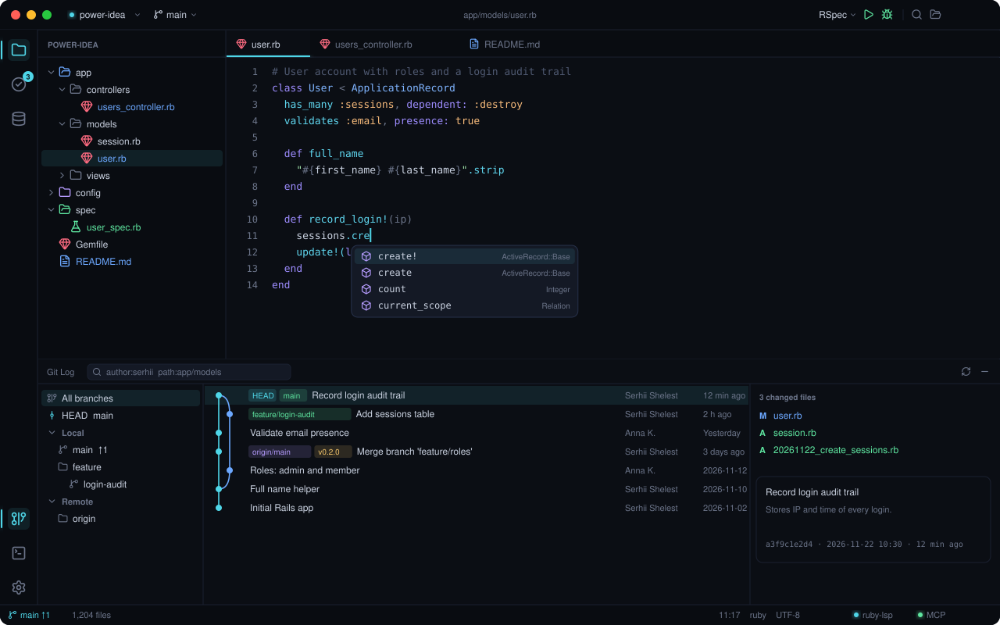
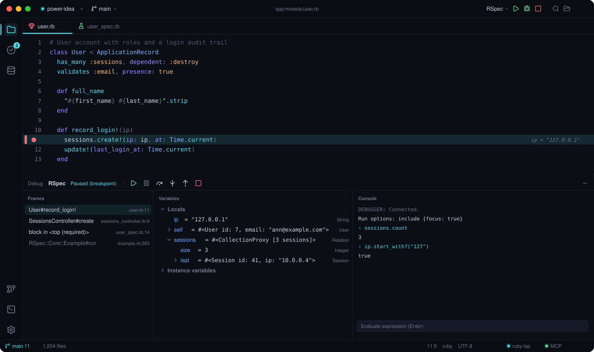
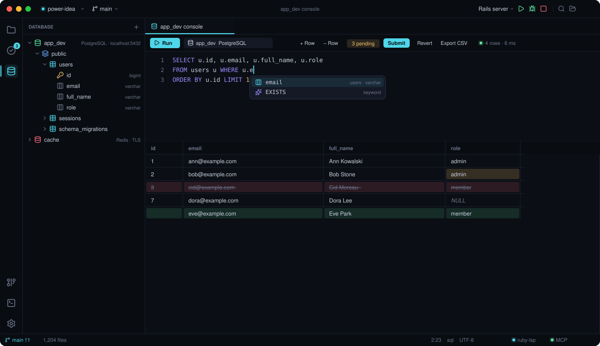
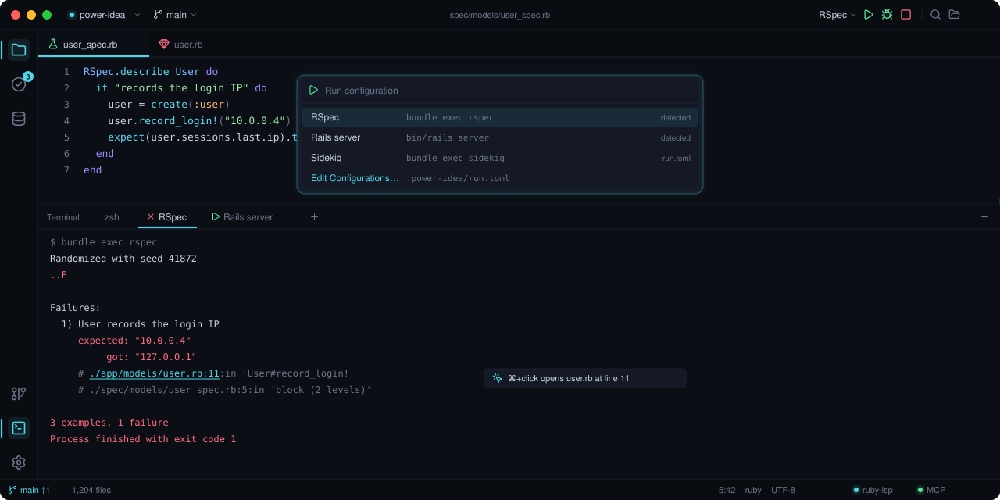
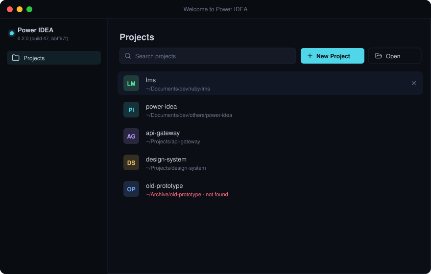

<div align="center">


# Power IDEA

**A fast, language-agnostic desktop IDE in Rust with JetBrains ergonomics.**

GPU-rendered UI, the JetBrains keymap you already know, language servers and
debuggers for any language, Git, databases, a real terminal — and an MCP server
so Claude Code can see what you see.


</div>

---

## A look inside

<p align="center"></p>

| Debugging any language (here: Ruby with rdbg) | Database console: completion, editing, export |
|---|---|
|  |  |
| **Run configurations, clickable stack traces** | **Welcome screen** |
|  |  |

<p align="center"><sub>Illustrations of the real UI in the Neo dark theme.</sub></p>

## Features

### Editor & code intelligence
- Tree-sitter highlighting for ~35 languages, tabs, JetBrains line operations (⌘D, ⌘⌫, ⌥⇧↑/↓, ⌘/).
- **Language Server Protocol** for any language: completion, hover, diagnostics,
  go to definition (⌘B / ⌘+click), back/forward (⌘[ / ⌘]).
- **Navigation**: Go to Class (⌘O), Go to Symbol (⌘⌥O), File Structure (⌘F12),
  Find Usages tool window (⌥F7), Rename (⇧F6), Reformat Code (⌥⌘L).
- Live **previews**: Markdown and SVG next to the editor (editor / split / preview), image viewer.

### Search
- Search Everywhere (⇧⇧), Go to File (⌘⇧O), Recent Files (⌘E), Find Action (⌘⇧A).
- Find in Files (⌘⇧F) and **Replace in Files** (⌘⇧R) with a live preview of every change.

### Run & Debug — any language
- **Run configurations** detected from the project (Rails, RSpec, Cargo, npm/yarn/pnpm/bun,
  Go, pytest, Django, Mix, Make) or written in `.power-idea/run.toml`. Each runs in its own
  terminal tab — colors, input, `pry`/`byebug` just work. Run ⌃R, Stop ⌘F2.
- **Debugging through the Debug Adapter Protocol**: rdbg (Ruby), lldb-dap (Rust, C/C++),
  debugpy (Python), dlv (Go). Breakpoints (⌘F8), Debug ⌃D, step over/into/out (F8/F7/⇧F8),
  frames, variables, console with expression evaluation.
- ⌘+click on `file:line` in any terminal output (stack traces, compiler errors) opens it.

### Git
- Commit tool window (⌘0) with changelists-style selection, amend, commit & push.
- **Git Log** (⌘9): commit graph, branches panel with ahead/behind, filters
  (`author:`, `path:`, `after:`, `before:`), cherry-pick, revert, reset, merge, rebase, conflict banner.
- Side-by-side diffs, push / pull / fetch, branch switching.

### Database
- PostgreSQL, MySQL/MariaDB, SQLite and Redis (with TLS); passwords in the macOS Keychain.
- Schema tree, SQL consoles (⌘↩) with table/column/alias completion.
- Edit cells, add and delete rows — submitted in one transaction. Export to CSV.

### Terminal
- Real terminal (alacritty_terminal) with tabs, scrollback, mouse support for TUI apps
  (vim, htop, lazygit), blinking cursor.

### Projects & workspace
- Welcome screen with recent projects and New Project (optional `git init`).
- Several projects as tabs of one window; open tabs, cursors and panels restored per project.
- Follows changes made outside the IDE (terminal, `git pull`, AI agents).
- Unsaved edits survive a Dock → Quit and come back on the next start.

### AI: MCP server for Claude Code
A local, token-protected MCP server exposes read-only tools: open files and the active
editor, project search, git status/diff/log, **LSP diagnostics, symbols, usages, file structure**,
plus "open this file / show this diff" navigation. Agents can look, but never write files or run commands.

## Build

Requirements: macOS 13+, Xcode Command Line Tools, and Rust via rustup.

```sh
xcode-select --install          # compilers, lldb-dap
brew install rustup && rustup-init
```

All scripts find the Rust toolchain on their own:

```sh
scripts/run.sh [project-dir]     # debug build, opens a project
scripts/build.sh                 # release "Power IDEA.app" in target/release/, then opens it
scripts/check.sh [--live]        # fmt + clippy + tests (--live: also against real ruby-lsp, rdbg, lldb-dap)
scripts/version.sh               # the version this checkout builds (from git tags, see below)
```

### Install or update

```sh
scripts/dmg.sh --install         # build dist/Power-IDEA-<version>-<build>.dmg and install it
scripts/dmg.sh                   # only build the disk image (drag the app onto Applications)
scripts/install.sh [file.dmg]    # install / update /Applications from a disk image (newest in dist/)
```

`install.sh` quits a running Power IDEA first (it still asks about unsaved changes),
replaces the app and starts the new version. Settings and projects are kept: they
live in `~/Library/Application Support/power-idea/`, not inside the app.

macOS remembers folder permissions per signing identity, so builds are signed with
a local certificate, "Power IDEA Local". The first build creates it in the login
keychain (macOS asks for your password once); later builds and updates reuse it, so
permissions survive. `POWER_IDEA_ADHOC=1` skips it (ad-hoc signature), and
`scripts/create-signing-cert.sh` creates it by hand.

## Development

```sh
bin/setup          # checks the tools (prints the brew command for missing ones) and installs git hooks
just check         # everything CI runs
```

| `just …` | What |
|---|---|
| `setup` | `bin/setup`: tools + lefthook git hooks (pre-commit: rustfmt, taplo, typos, gitleaks; commit-msg: Conventional Commits; pre-push: clippy, tests, cargo-deny) |
| `fmt` / `fmt-check` | rustfmt + taplo |
| `lint` | clippy with warnings as errors (strict workspace lints in `Cargo.toml`), typos, cargo-machete |
| `test` | cargo-nextest + doctests |
| `cov` | coverage (cargo-llvm-cov); fails under the threshold in the `justfile` |
| `msrv` | build with the `rust-version` from `Cargo.toml` |
| `audit` / `deny` | RustSec advisories / cargo-deny (advisories, licenses, bans, sources) |
| `check` | all of the above plus secret scanning and the workflow linters |
| `changelog` / `release` | see Versioning & releases |

CI (GitHub Actions) runs the same checks. Daily `cargo audit`,
CodeQL and OpenSSF Scorecard run separately; Dependabot updates crates and actions weekly. See
[CONTRIBUTING.md](CONTRIBUTING.md) and [SECURITY.md](SECURITY.md).

## Versioning & releases

Git is the single source of truth: nobody edits version numbers or the changelog by hand.

- **Version** = the latest annotated tag `v*` (`v1.5.0` → `1.5.0`); **build** = `git rev-list --count HEAD`.
  A build on the tag shows `1.5.0 (412)`, later commits `1.5.0-dev.3+abc1234` (`.dirty` with uncommitted
  changes). `scripts/version.sh` computes it (`--json` too); the app embeds it at build time, shows it on the
  Welcome screen and in About (click / Copy Version Details copies it for bug reports), and the `.app`
  bundle's Info.plist gets it. Without git, `APP_VERSION` / `APP_BUILD` / `GIT_SHA` are used.
- **Commits** follow [Conventional Commits](https://www.conventionalcommits.org): `feat(git): add …`,
  `fix: …`, `perf:`, `refactor:`, `docs:`, `test:`, `chore:`, `ci:`, `build:`; `!` or `BREAKING CHANGE:`
  for breaking changes. A commit-msg hook (`bin/setup`) checks them; merge and revert commits pass.
- **`bin/changelog`** regenerates `CHANGELOG.md` ([Keep a Changelog](https://keepachangelog.com), via
  [git-cliff](https://git-cliff.org), config in `cliff.toml`) and prints `[Unreleased]`: what goes into the
  next version. Install git-cliff with `brew install git-cliff`.
- **`bin/release [major|minor|patch|auto]`** (default `auto`: breaking → major, minor on 0.x; feat → minor;
  else patch) refuses a dirty tree or a branch other than `main`, shows the plan and asks, then writes the
  changelog section and `release-notes/vX.Y.Z.md`, commits `chore(release): vX.Y.Z` and creates the annotated
  tag. It never pushes; it prints `git push --follow-tags` (the release workflow then publishes the build).

## Language servers and debuggers

Power IDEA uses whatever is installed; missing tools are offered in Settings → Languages.

| Language | Language server | Debugger |
|---|---|---|
| Ruby | `gem install ruby-lsp` | `gem install debug` (rdbg) |
| Rust | `rustup component add rust-analyzer` | lldb-dap (Xcode CLT) |
| TypeScript / JavaScript | `npm i -g typescript-language-server typescript` | — |
| Python | `npm i -g pyright` | `pip install debugpy` |
| Go | `go install golang.org/x/tools/gopls@latest` | `go install github.com/go-delve/delve/cmd/dlv@latest` |

## Connect Claude Code

Click **MCP** in the status bar — it copies the command with your local token:

```sh
claude mcp add --transport http power-idea http://127.0.0.1:<port>/mcp --header "Authorization: Bearer <token>"
```

## Configuration

| File | What |
|---|---|
| `~/Library/Application Support/power-idea/config.toml` | appearance, editor, terminal, language servers |
| `~/Library/Application Support/power-idea/keymap.toml` | your key bindings on top of the JetBrains defaults |
| `<project>/.power-idea/settings.toml` | project settings (excludes, tab size) |
| `<project>/.power-idea/run.toml` | run and debug configurations |
| `<project>/.power-idea/databases.toml` | data sources (no passwords) |
| `<project>/.power-idea/workspace.toml` | personal state (open tabs…), git-ignored |

Example `run.toml`:

```toml
[[config]]
name = "RSpec"
command = "bundle exec rspec"
env = { RAILS_ENV = "test" }

[config.debug]          # Debug ⌃D
adapter = "ruby"        # ruby | lldb | python | go
```

## Architecture

```
crates/
  app/     the gpui application (the only crate that depends on gpui-kit)
  search/  file index, fuzzy matching, find & replace in files
  vcs/     git through the system git CLI
  lsp/     Language Server Protocol client
  dap/     Debug Adapter Protocol client and adapter launch plans
  run/     run configurations and file:line links in program output
  db/      PostgreSQL / MySQL / SQLite (sqlx) and Redis
  mcp/     MCP server (JSON-RPC over local HTTP)
```

Logic lives in UI-free crates with unit tests; the `app` crate wires state to views.
See [`CLAUDE.md`](CLAUDE.md) for the conventions and [`PROGRESS.md`](PROGRESS.md) for what is done and what is next.

## License

MIT
